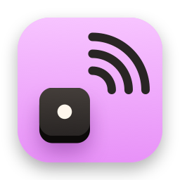
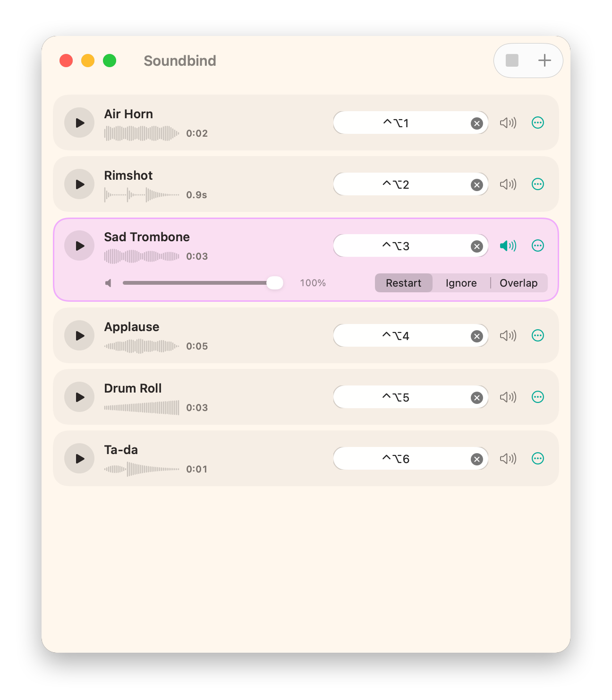
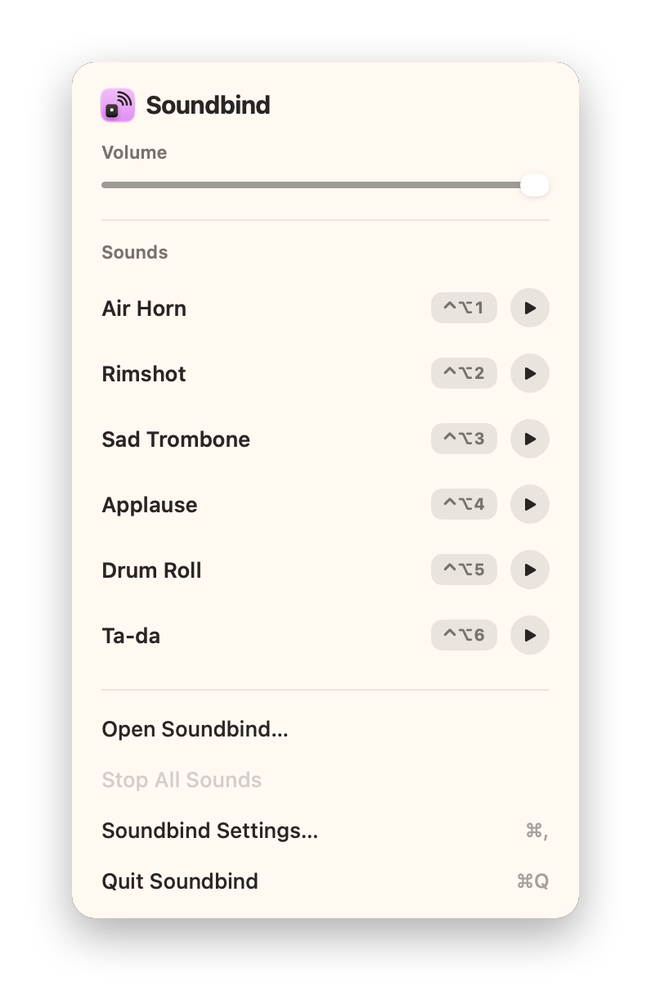
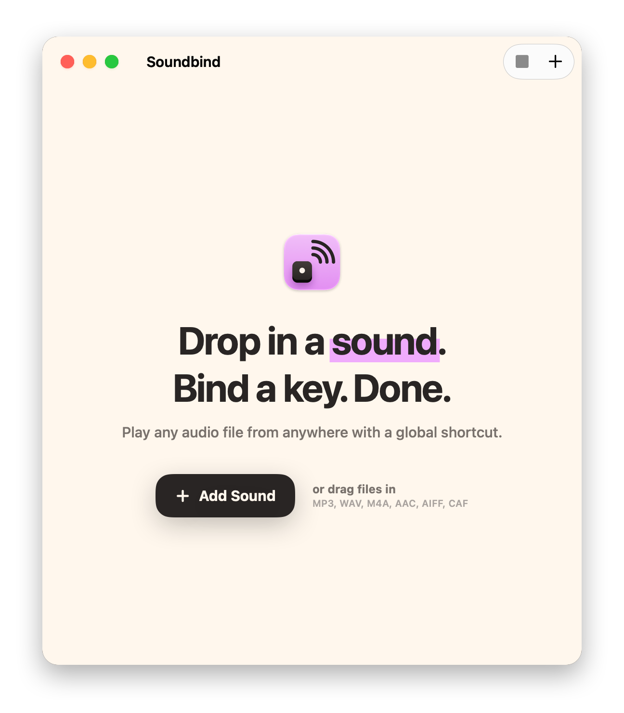

<div align="center">
  
  <h1>Soundbind</h1>
  <h3>Drop in a sound. Bind a key. Done.</h3>
  <p>A tiny native macOS menu bar soundboard.<br>Play any audio file from anywhere with a global keyboard shortcut.</p>

  
  
  [](LICENSE)

  <p><a href="#install"><b>Install</b></a> · <a href="#how-it-works">How it works</a> · <a href="#why-soundbind">Why Soundbind</a> · <a href="#contributing">Contributing</a></p>

  <picture>
    <source media="(prefers-color-scheme: dark)" srcset="docs/images/main-dark.png">
    
  </picture>
</div>

## How it works

<table>
  <tr>
    <td width="33%" valign="top"><h3>1. Drop in a sound</h3>Drag audio files onto the window, or press <code>⌘O</code>. MP3, WAV, M4A, AAC, AIFF and CAF all work.</td>
    <td width="33%" valign="top"><h3>2. Bind a key</h3>Click the shortcut field on a sound and press any key combination.</td>
    <td width="33%" valign="top"><h3>3. Done</h3>Press it in any app and the sound plays, even with the Soundbind window closed.</td>
  </tr>
</table>

## Why Soundbind

<table>
  <tr>
    <td width="50%" valign="top">
      <h3>It stays out of your way</h3>
      <p>Soundbind lives in the menu bar. The popover lists every sound with its shortcut, a play button and a master volume slider, so you rarely need the main window at all.</p>
      <h3>It asks for nothing</h3>
      <p>No Accessibility permission, no account, no network access, no analytics. It is sandboxed, and your sounds never leave your Mac.</p>
      <h3>It is fast</h3>
      <p>Sounds are preloaded into memory, so a key press plays instantly. Up to 24 sounds can overlap.</p>
      <h3>Each sound behaves how you want</h3>
      <p>Set a volume per sound, and choose what a repeat press does: restart it, ignore it, or layer another copy on top.</p>
    </td>
    <td width="50%" align="center" valign="top">
      <picture>
    <source media="(prefers-color-scheme: dark)" srcset="docs/images/popover-dark.png">
    
  </picture>
    </td>
  </tr>
</table>

<div align="center">
  <picture>
    <source media="(prefers-color-scheme: dark)" srcset="docs/images/empty-dark.png">
    
  </picture>
</div>

## Install

1. Download **[Soundbind-0.0.1.dmg](https://github.com/tusharonly/Soundbind/releases/latest)** from the latest release.
2. Open it and drag **Soundbind** into **Applications**.
3. Open Soundbind, then click the key-and-sound-waves icon in the menu bar and choose **Open Soundbind…**.

Requires macOS 14 or later, on Apple silicon or Intel.

> [!IMPORTANT]
> Soundbind is not yet notarized by Apple, so macOS blocks it the first time. After trying to open it once, go to **System Settings > Privacy & Security**, scroll down and click **Open Anyway**. Or run this once in Terminal:
>
> ```sh
> xattr -dr com.apple.quarantine /Applications/Soundbind.app
> ```

<details>
<summary><b>Build from source instead</b></summary>

You need Xcode 16.3 or later and [XcodeGen](https://github.com/yonaskolb/XcodeGen).

```sh
brew install xcodegen
git clone https://github.com/tusharonly/Soundbind.git
cd Soundbind
xcodegen generate
xcodebuild -scheme Soundbind -derivedDataPath build build
open build/Build/Products/Debug/Soundbind.app
```

`scripts/make_dmg.sh` builds the release disk image.

</details>

## Keyboard

| Key | In the sound list |
|---|---|
| `↑` / `↓` | Move the selection |
| `Space` | Play or stop the selected sound |
| `Return` | Rename |
| `Delete` | Delete, with Undo (`⌘Z`) |
| `⌘.` | Stop all sounds |
| `⌘,` | Settings: launch at login, Dock icon, master volume, a global Stop All shortcut |

## Contributing

Issues and pull requests are welcome. This is a small side project, so replies may take a while.

Run `xcodebuild -scheme Soundbind test` before opening a pull request. The [architecture notes](docs/architecture.md) explain how the app is built, and the [manual test checklist](docs/manual-testing.md) covers what the unit tests can't.

## License

[MIT](LICENSE) © 2026 Tushar Ghige. Global shortcuts are powered by [KeyboardShortcuts](https://github.com/sindresorhus/KeyboardShortcuts).
